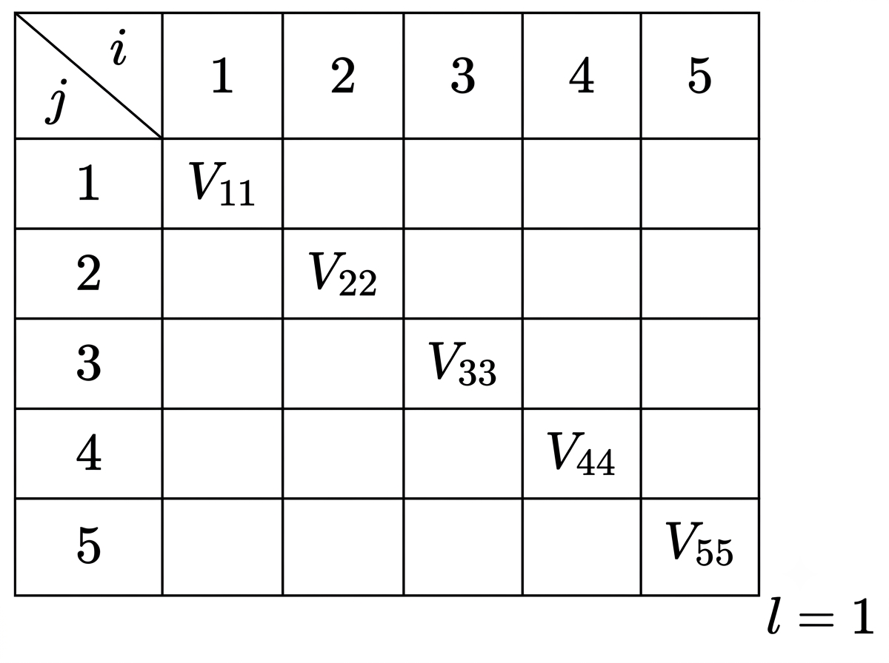
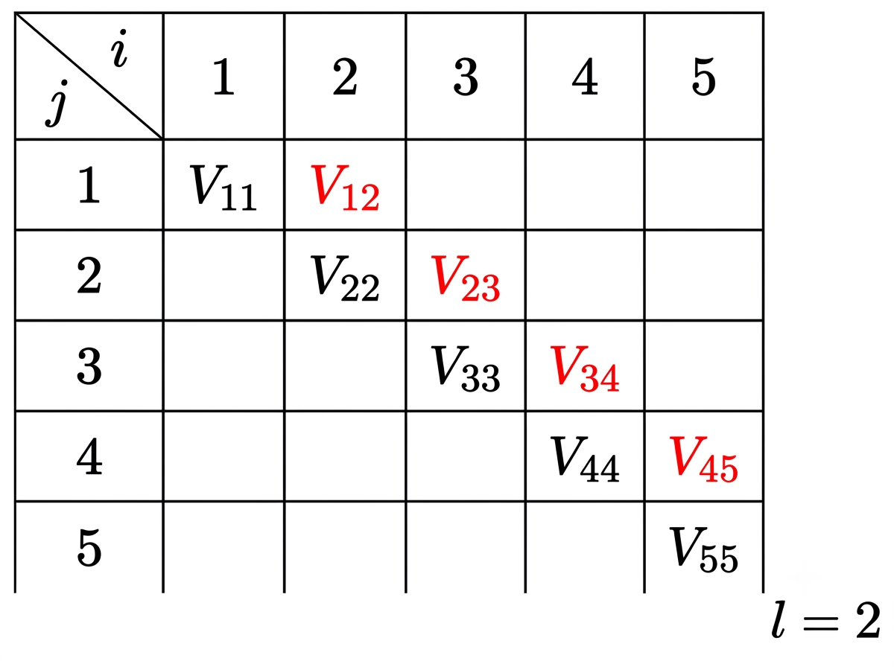
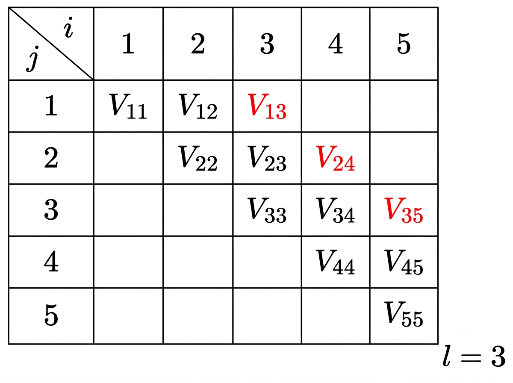
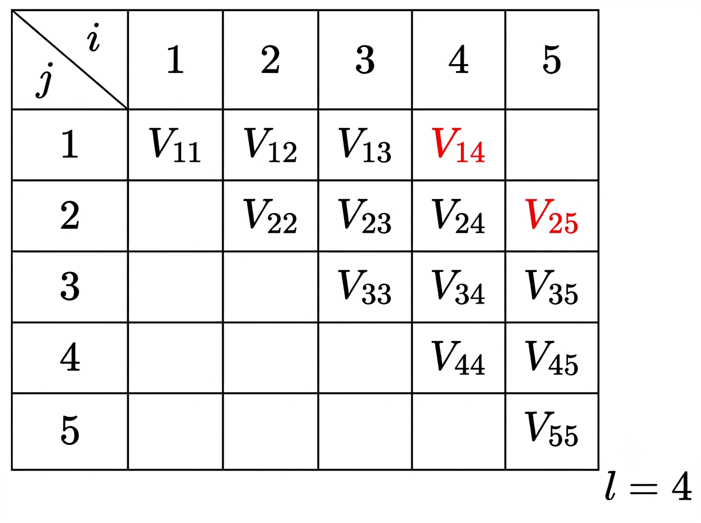
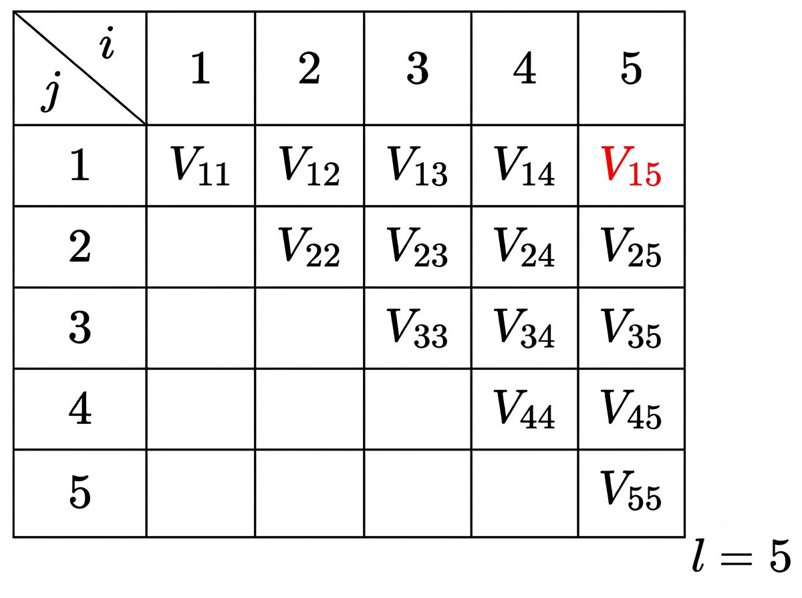

## 1. Chomsky Normal Form

CFG 중, 다음과 같은 form의 production만을 가지면 Chomsky Normal Form이라 한다.

$$
A \rightarrow BC, \quad A \rightarrow a
$$

즉, Chomsky Normal Form이 되려면 CFG를 만족하고, 모든 production이 화살표 오른쪽에 Variable이 2개만 있거나, single terminal symbol만 있어야 한다. 앞으로 Chomsky Normal Form을 간단히 CNF라 하자.

가령 $S \rightarrow BS\mid b$, $B \rightarrow SB \mid a$는 CNF이다. 

$S \rightarrow AS\mid AAS$, $A \rightarrow SA\mid aa$는 CFG이지만, 주어진 production 중 $S \rightarrow AAS$는 우측에 변수가 3개, $A \rightarrow aa$는 terminal symbol이 2개이므로 CNF가 아니다.

CNF는 모든 CFG를 일정한 형태로 통일할 수 있기 때문에, CNF로 변환하면 증명과 분석을 쉽게 할 수 있다. 즉 CFG를 다루기 쉬운 표준 형태로 변환하는 데 의의가 있다.

## 2. CFG를 CNF로 변환할 수 있다.

빈 문자열 $\lambda$를 생성하지 않는 CFG $G=(V,T,S,P)$를 동치인 CNF $\hat{G}=(\hat{V},\hat{T},S,\hat{P})$ 로 변환할 수 있다.

### 2. 1. Proof

$\lambda$ productions, unit-productions가 없는 grammar $G$를 생각하자.

**Step 1: $G$를 CFG인 $G_1=(V_1, T_1, S_1, P_1)$로 변환**

- production의 우변 길이가 1이라면, $G$는 unit-productions가 없으므로 $G_1$은 single terminal symbol을 produce하는 $A \rightarrow a$만 가진다.
- production의 우변 길이가 2 이상이라면, single terminal symbol $a$를 새 Variable $B_a$로 대체하고, $P_1$에 $B_a \rightarrow a$를 추가한다. 이 과정에서 우변에 Variable만 남게 된다.
    
    예를 들어, 주어진 문법 $G$의$G$$A \rightarrow aBCb$ 이라면, $A \rightarrow B_aBCb$로 바꾸고, $B_a \rightarrow a$를 추가한다. 같은 방식으로 한번 더 $A \rightarrow B_aBCB_b$로 바꾸고, $B_b \rightarrow b$를 추가한다.
    
    따라서 새로운 production $P_1$은 다음과 같다.
    
    $$
    \begin{align*}
    P_1:\quad &A \rightarrow B_aBCB_b, 
    \\
    &B_a \rightarrow a,
    \\
    &B_b \rightarrow b
    \end{align*}
    $$
    

**Step 2: $G_1$을 CNF인 $\hat{G}=(\hat{V},\hat{T},S,\hat{P})$로 변환**

- $P_1$에서 우변 길이가 1인 production은 $A \rightarrow a$, 길이가 2인 production은 $A \rightarrow BC$꼴이다. 따라서 이 둘은 CNF를 만족하므로 그대로 $\hat{P}$에 추가한다.
- $P_1$에서 길이가 3 이상인 production은 $A \rightarrow C_{1}C_{2} \cdots C_{n}$ ($C_i \in V$) 형태이다. 여기서 가장 앞의 $C_1$을 제외한 $C_2 \cdots C_n$을 새 variable $D_1$이 produce하도록 만든다.
    
    $D_1 = C_2 \cdots C_n$라고 두면 기존 production은 $A→C_1D_1$이 된다. $D_1$에 $D_1$$D_1=C_2D_2$ ($D_2 = C_3 \cdots C_n$)로 쓸 수 있고, 이를 반복해 나가면 모든 production이 $A \rightarrow BC$꼴이 되어 $\hat{P}$에 추가할 수 있다. 
    
- 완성된 $\hat{P}$는 $A \rightarrow a$, $A \rightarrow BC$꼴만 가지므로, $\hat{G}$는 CNF이다.

### 2. 2. Example

$$
\begin{aligned}
S &\to aABb \mid b \\
A &\to aA \mid a \\
B &\to bB \mid b
\end{aligned}
$$

위 CFG를 Chomsky Normal Form으로 바꿔보자.

$\lambda$ - production과 unit production이 없으므로, 바로 변환 과정을 적용할 수 있다.

Step 1: 우변 길이가 2 이상인 production에 대해,

$S \to aABb$에서, $B_a \to a$를 추가하여 $S \to B_aABb$로 만든다. 다시 $B_b = b$를 추가하여 $S \to B_aABB_b$로 만든다. 

$A \to aA$와 $B \to bB$에 위에서 만든 production을 적용하면 $A \to B_aA,\ B \to B_bB$가 된다.

Step 2: 길이가 3 이상인 우변을 분해

$S \to B_aABB_b$의 우변 길이는 4다. 따라서 새 변수 $D_1=ABB_a,\ D_2=BB_a$로 두자. 그러면 우변 길이가 3 이상인 production은 $S \to B_aD_1$, $D_1=AD_2$로 바꿀 수 있다.

따라서 최종적으로  

$$
\boxed{
\begin{aligned}
S &\to B_aD_1 \mid b \\
D_1 &\to AD_2 \\
D_2 &\to BB_a \\
A &\to B_aA \mid a \\
B &\to B_bB \mid b \\
B_a &\to a \\
B_b &\to b
\end{aligned}
}
$$

모든 production의 우변이 single terminal symbol 또는 2개의 Variable 형태이므로 CNF이다.

## 3. CYK Algorithm

우리가 Chomsky Normal Form을 다루는 주된 목적은, membership problem을 해결하기 위해서이다. 

결론부터 말하면 CNF에 적용할 수 있는 parsing algorithm인 **CYK Algorithm**을 이용하여 모든 CNF의 membership을 판정할 수 있다.

### 3.1. 가정

CNF인 grammar $G$와  string $w=a_1 a_2 \cdots a_n$을 생각하자.

이때 $w_{ij}=a_i \cdots a_j$이고, $V_{ij}=\{A\in V : A \Rightarrow^{*} w_{ij}\}$이다. 즉, $w_{ij}$는 전체 string에서 $i$번째 symbol부터 $j$번째 symbol을 가져온 substring이고, $V_{ij}$는 $V$ 중, $w_{ij}$를 produce할 수 있는 variables의 집합이다.

CYK Algorithm의 기본적인 idea는 다음과 같다.

$V_{1n}$, 즉 $w_{1n}=w$을 produce할 수 있는 variable 집합을 찾고, 그 안에 start variable $S$가 있다면 $w$는 $G$의 member라고 판단할 수 있다.  

$$
w \in L(G) \iff S \in V_{1n}
$$

결국 우리 목표는 $V_{1n}$을 찾는 것이라고 할 수 있다. 

### 3. 2. $V$를 구하는 몇 가지 예시

두 index의 거리가 0일 때, 즉 $V_{ii}$에 대해 생각해보자. single terminal symbol $a_i$를 produce할 수 있는 variable 집합을 의미하므로,

$$
V_{ii}=\{ A \in V : A \to a_i \}
$$

이번에는 두 index의 거리가 1일 때, 예를 들어 $V_{12}$에 대해 생각해보자. $V_{12}$의 variable은 $a_1a_2$를 produce할 수 있어야 한다.

위에서 찾은 $V_{ii}$를 이용하면 $a_1$를 produce하는 $B \in V_{11}$, $a_2$를 produce하는 $C \in V_{22}$를 생각해볼 수 있다.

$$
V_{12}=\{\ A \in V\  : \ A \to BC,\ B\in V_{11},\ C\in V_{22}\ \}
$$

마지막으로 두 index의 거리가 2일 때, 예를 들어 $V_{13}$에 대해 생각해보자. 이번 예를 이해하면 $V_{ij}$로 일반화할 수 있을 것이다.

우선 $V_{13}$의 variable은 $a_1a_2a_3$을 produce하는 변수이다. 이때 우리가 생각할 수 있는 분할은 $a_1 \mid a_2a_3$, $a_1a_2 \mid a_3$ 2가지이다.  

‘왜 $a_1|a_2|a_3$는 안될까’라는 의문이 들면, 3.1.에서 CYK Alogorithm에 주어진 grammar $G$가 CNF이므로, CNF의 grammar를 따라야 한다는 점을 기억하자.

**i)** $\ a_1|a_2a_3$ 을 생성하는 Variable

$A \to BC$에서 $B$가 $a_1$을 생성하고, $C$가 $a_2a_3$을 생성하면 되므로 $\{A \in V\ :\ A \to BC,\ B \in V_{11}, C \in V_{23} \}$ 임을 어렵지 않게 알 수 있다.  

**ii) $a_1a_2|a_3$ 을 생성하는 Variable**

이번엔 $B$가 $a_1a_2$를 생성하고, $C$가 $a_3$을 생성하면 되므로 $\{ A \in V\ :\ A \to BC,\ B \in V_{12}, C \in V_{3} \}$이다.

따라서 $\mathrm{i}),\ \mathrm{ii})$ 을 union으로 연결하면

$$
V_{13}=\{A \in V\ :\ A \to BC,\ B \in V_{11}, C \in V_{23} \}\
\cup \
\{A \in V\ :\ A \to BC,\ B \in V_{12}, C \in V_{33} \}

$$

즉 2개로 분할되는 string을 생성하는 variable은 2개 집합의 union으로 나타난다. 만약 분할 가능한 case가 n개라면, 해당 variable은 n개 집합의 union으로 나타날 것임을 직관적으로 알 수 있다.

직전에 살펴본 $V_{12},\ V_{13}$을 통해 임의의 문자열 $V_{ij}$는 다음과 같음을 알 수 있다.

$$
 V_{ij}= \cdots \cup \ \{ A \in V\ :\ A \to BC,\ B \in V_{ik},\ C \in V_{k+1,j} \}
$$

여기서 $k\ (k \in [i,j-1])$는 $w_{i,j}$를 몇번째 문자 뒤에서 분할했는지 나타내는 index이다. 식을 보면 알 수 있듯이, 바로 임의의 variable $V_{ij}$를 알 수는 없다.

전체 string을 2개의 substring으로 나누더라도$(A \to BC)$, 각 substring을 생성하는 variable 집합을 알아내야 하기 때문이다. $(V_{ik},\ V_{k+1,j})$

### 3. 3. CYK Algorithm

자 이제 $V_{ij}$를 구하는 법을 알았으니 원래 우리 목적인 $V_{1n}$을 구해보자. 

바로 $V_{1n}$을 계산할 수 없으므로 길이가 짧은 substring을 생성하는 variable 집합을 구하고, 그 결과를 조합하여 더 긴 substring의 결과를 구하는 순서로 계산한다.

Algorithm은 다음과 같은 단계로 진행된다.

- Step 1: $V_{11}, V_{22}, V_{V33}, \cdots ,\ V_{nn}$ 구하기 (index 거리 0, substring 길이: 1)
- Step 2: $V_{12}, V_{23}, V_{34}, \cdots ,\ V_{n-1,n}$ 구하기 (index 거리 1, substring 길이: 2)
- Step 3: $V_{13}, V_{24}, \cdots ,\ V_{n-2,n}$ 구하기 (index 거리 2, substring 길이: 3)
- Step 4: index 거리, 즉 substring의 길이를 늘려가면서 반복하여 구하기
- Step 5: $V_{1n}$ 구하기.

### 3. 4. Application

$w=baaba$가 아래와 같은 Production을 갖는 grammar $G$의 member인지 확인해보자.

$P:$
$\begin{aligned}
S &\to AB \mid BC ,\\
A &\to BA\mid a, \\
B &\to CC \mid b, \\
C &\to AB \mid a 
\end{aligned}$

CYK Algorithm을 적용하는 과정을 이해하기 쉽게, 각 단계별로 연산해야하는 대상을 표로 나타낼 것이다. 

표에서 $l$은 현재 구하는 $V_{ij}$에서의 substring길이이다. $w$의 길이가 5이므로 우리는 $V_{15}$를 구해 $S$가 있는지 확인하면 된다.

우선 길이가 1인 substring을 생성하는 variable 집합인 $V_{ii}$를 구하자.



계산하면 $V_{11}=\{B\},\ V_{22}=\{A,C\},\ V_{33}=\{A,C\},\ V_{44}=\{B\},\ V_{55}=\{A,C\}$ 을 얻는다.

목표는 $V_{15}$을 찾는 것이므로, 표의 대각선 셀 아래 방향은 채울 필요가 없다. $V_{15}$을 구하는데 필요한 셀만 찾아나가면 된다.

이제 길이가 2인 substring을 생성하는 variable 집합을 구하고 계산한다. 



$V_{12}=\{ X \in V_{11}, Y \in V_{22}\}$이므로 $V_{12}=\{A,S\}$ 이다. 같은 방식으로 계산하면

$V_{23}=\{B\},\ V_{34}=\{C,S\},\ V_{45}=\{A,S\}$이다. 



$w_{13}=baa$는 $b\mid aa$ 또는 $ba \mid a$로 나눌 수 있고, 이에 따라 $V_{13}$도 2개 집합의 합집합으로 표현됐던 것을 기억하여 계산하자.

즉, 우리는 $V_{11},\ V_{23},\ V_{12},\ V_{33}$을 이용해 $V_{13}$을 구할 수 있다.

$V_{13}= \varnothing,\ V_{24}= \{B \},\ V_{35}=\{B\}$ 



$V_{14}=\emptyset,\ V_{25}=\{A,C,S\}$



$\therefore V_{15}=\{A,C,S\}$ 이다.

$w$의 길이는 5이고, $V_{15}$에 $S$가 있으므로 $w$는 $G$의 member임을 알 수 있다.

### 3. 5. $O(n)$

CYK Algorithm의 시간복잡도는 string 길이가 $n=|w|$에 대해 $O(n^3)=O(|w|^3)$이다. 즉, $|w|^3$ 안에 우리는 $w$가 CNF를 만족하는 $G$의 member인지 판별할 수 있다.

아래 Pseudo code를 보자.

```

CYK(G = (V, T, S, P), w = a₁a₂...aₙ):

    모든 V[i, j]를 공집합으로 초기화
    
    # 길이 1인 부분문자열, 이때 시간복잡도는 O(n)
    for i = 1 to n:
        for each production A → a in P:
            if a = aᵢ:
                V[i, i] ← V[i, i] ∪ {A}

    # 길이 2 이상인 부분문자열
    for l = 2 to n:                              # l은 substring의 총 길이 (2~n까지 가능)
        for i = 1 to n - l + 1:                  # i는 substring에서 탐색을 시작하는 index (n-l+1이 substring 마지막 symbol index)
            j ← i + l - 1                        # j는 substring에서 탐색을 끝내는 index

            for k = i to j - 1:                  # k는 분할된 2번째 substring 시작하는 index
                for each production A → BC in P:
                    if B ∈ V[i, k] and C ∈ V[k + 1, j]: #production 검사
                        V[i, j] ← V[i, j] ∪ {A}

    return S ∈ V[1, n]
```

substring의 총 길이 $l$에 대해 $n-1$번 반복문이 시행된다. 각 $l$값 마다, 시작위치 $i$가 바뀌므로 시작 위치는 $n-l+1$개
